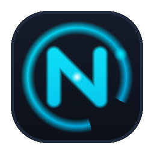

<p align="center">
  
</p>

<h1 align="center">NgaRingApi</h1>

<p align="center">
  <strong>Fast, Local-First API IDE and Testing Environment</strong><br>
  Built for developers who value data privacy, Git collaboration, and raw performance.
</p>

<p align="center">
  <a href="license.md"></a>
  
  
  
</p>

---

## Overview

**NgaRingApi** is a modern, developer-centric API client and IDE designed to replace bloated cloud-based tools. 

Instead of storing your sensitive API requests, credentials, and test suites in a remote vendor database, NgaRingApi saves your collections directly on your local filesystem using plain-text files.

### Why NgaRingApi?

- **Local-First Architecture:** Your collections, environment variables, and request data reside on your disk. NgaRingApi functions completely offline.
- **Native Git Collaboration:** Every request is a readable file. Commit, create pull requests, review diffs, and resolve merge conflicts using your existing Git workflow.
- **Fast & Snappy:** Built with Rsbuild and modern React for instant startup and rapid response rendering.
- **Zero Cloud Lock-in:** No forced account creation, no tracking telemetry of your payloads, and no subscription walls for core features.
- **Multi-Protocol Support:** Seamlessly test REST, GraphQL, gRPC, and WebSocket APIs in one unified workspace.

---

## Core Capabilities

| Feature | Description |
| :--- | :--- |
| **Request Builder** | Comprehensive support for URL parameters, custom headers, body types (JSON, XML, Form-Data, Binary, Raw). |
| **Response Inspector** | Syntax-highlighted viewer with search, formatted JSON tree, response headers, status codes, and latency metrics. |
| **Environment Management** | Multi-environment support with secret masking, inheritance, and dynamic variable interpolation. |
| **Automated Testing** | Write pre-request scripts and assertions with a built-in test runner using familiar JavaScript syntax. |
| **Collection Runner** | Run batches of requests sequentially with configurable iterations and detailed reporting. |
| **Design System** | Tailored dark and light themes featuring high-contrast Cyber-Cyan and Ocean-Teal palettes. |

---

## Getting Started

### Prerequisites

- [Bun](https://bun.sh/) (v1.1+ recommended) or [Node.js](https://nodejs.org/) (v20+ LTS)
- [Git](https://git-scm.com/)

### Installation from Source

1. **Clone the repository:**
   ```bash
   git clone https://github.com/nyawit-dev/ngaRing-Api.git
   cd ngaRing-Api
   ```

2. **Install dependencies:**
   ```bash
   bun run setup
   ```

3. **Start the development application:**
   - **Desktop (Electron):**
     ```bash
     bun run dev
     ```
   - **Web Browser Interface:**
     ```bash
     bun run dev:web
     ```

---

## Building Desktop Packages

NgaRingApi can be compiled into standalone native packages for Windows, macOS, and Linux:

```bash
# Production Web Build
bun run build:web

# Windows Installer (.exe)
bun run build:electron:win

# macOS Installer (.dmg / .pkg)
bun run build:electron:mac

# Linux Package (.AppImage / .deb)
bun run build:electron:linux
```

Packaged installers will be generated inside the `packages/bruno-electron/out` directory.

---

## Project Structure

```text
├── assets/                  # Application icons, branding, and imagery
├── packages/
│   ├── bruno-app/           # Core React frontend interface and IDE panels
│   ├── bruno-electron/      # Electron main process, window management, and native shell
│   ├── bruno-common/        # Shared utility functions and common data structures
│   ├── bruno-filestore/     # Local disk storage and collection persistence engine
│   ├── bruno-requests/      # Network dispatchers (HTTP, HTTPS, gRPC, WS)
│   ├── bruno-schema/        # Validation schemas for requests and environments
│   └── bruno-lang/          # Language parsers and serializers
└── DESIGN.md                # Design system specification and token guidelines
```

---

## License & Attribution

**NgaRingApi** is distributed under the [MIT License](license.md).

This project is built upon the open-source foundation of Bruno, created by Anoop M D and contributors under the MIT License. We gratefully acknowledge the original authors and the open-source community for pioneering local-first API tooling.
